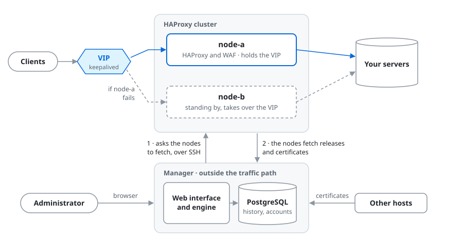

# Haprion

A web interface and command-line engine for running small HAProxy clusters: load balancing, a
virtual address that moves between the nodes, a WAF and certificates, from one place - without
having to work with HAProxy every day.

## Project status

Haprion is a personal hobby project. I had outgrown Nginx Proxy Manager and wanted something in
the same spirit that also understood high availability: two or more nodes sharing a virtual
address, certificates issued and distributed from one place, load balancing to the servers behind,
and a WAF in front of them - while staying reasonably easy to use for someone who does not work
with networks, proxies or load balancers on a daily basis. In practice that means a home lab, and
possibly a smaller company.

It is useful to me, and I hope it may be useful to others too, but expectations should be adjusted
accordingly. This is not a commercial product: there is no SLA, no support agreement and no
guaranteed response time, and maintenance is best-effort. There will be bugs.

The project has not reached 1.0 and is **not yet declared ready for production deployment**.
Everything listed below is built and tested, and everything the interface sets is also a command.
What remains before 1.0 is a full re-verification of an installation built from this repository,
and documentation.

**Built with AI.** The code is written by [Claude](https://claude.ai) and
[Codex](https://openai.com/codex/). The design, the product decisions and the direction are mine -
I describe what I want, review the results and decide what stays. I have written perhaps ten lines
of shell myself; the rest was done by AI.

## How an installation looks

<picture>
  <source media="(prefers-color-scheme: dark)" srcset="docs/images/installation-dark.svg">
  
</picture>

The **manager** is a machine of its own. It holds the configuration, the published versions, the
keys and the certificates, and runs the web interface; one manager can look after several
clusters. The **nodes** carry the traffic: the one holding the virtual address answers, and when it
fails keepalived moves the address to another. Clients never pass through the manager, so without
it the nodes go on serving - what stops is changing anything.

The manager never pushes to a node. It asks the node to fetch, and the node checks a release before
it switches to it. Other hosts that need a certificate - a mail server, a NAS, a hypervisor - can
be registered to fetch theirs from the manager the same way.

## What you need

| Machine | How many | Operating system | Size to start from |
|---|---|---|---|
| Manager | one | Ubuntu 26.04 or Debian 13, amd64 | 2 vCPU, 4 GB memory |
| HAProxy node | two to eight per cluster | Ubuntu 26.04 or Debian 13, amd64 | 1 vCPU, 1 GB memory; 2 GB with the WAF |

- Virtual machines are fine, and are what Haprion is tested on. A single node also works, without
  failover.
- The nodes of a cluster share one network segment: keepalived moves the virtual address between
  them with VRRP. The manager reaches each node over SSH.
- A node's disk grows with its traffic log; [Installing](docs/install.md#requirements) has the
  sum. How far one vCPU goes, with and without the WAF, is under
  *Size* under [the nodes](docs/user-manual.md#part-2--the-nodes) in the manual.

## Screenshots

Screenshots will be added.

## Getting started

**Start with the [quickstart](docs/quickstart.md)**: from empty machines to a site served by your
HAProxy pair. The manager is installed with its packages and one command, `sudo haprion-setup`;
each node with its package, which prints the block the manager joins it with. From there a new
installation's dashboard walks through the first cluster - its name and address, the nodes, the
first deploy. [Installing](docs/install.md) covers
the installation, and the [user manual](docs/user-manual.md) is the reference for everything else.

## What it does

**Proxies and clusters**

- HTTP, HTTPS and TCP objects edited as drafts and published as versions; a deploy rolls a
  published version out node by node and is bound to the version the person saw
- DNS load balancing through dnsdist, and syslog over UDP
- a cluster's network and virtual addresses, carried by keepalived
- draining a server, maintenance, and replacing a certificate without reloading HAProxy
- a server written as a name the manager cannot resolve is pointed out where it is typed and where
  it is published, before a deploy finds it on a node
- adding or removing a node, which publishes the new membership and, when the cluster was up to
  date, deploys it in the same job
- counters shared between a cluster's nodes, so a failover or a deploy does not start them again

**Access and protection**

- who may reach an object - by address, range, named network or country - and who may not
- rules on path, method and headers, a per-source rate limit per object, and a brake per cluster
  on any single source address
- a WAF engine (Coraza with the OWASP Core Rule Set), in log or block mode per object, with
  exceptions made from the findings
- an advanced configuration layer per object, behind a feature switch, for what the forms do not
  cover

**Certificates**

- issuance from one form through ACME, with HTTP-01 or DNS-01; DNS provider credentials are sealed
  by the web process and opened only by a root helper
- enrollment and renewal from a Microsoft CA over NDES/SCEP
- import of a certificate issued elsewhere, a key and signing request made on the manager, and
  export of a certificate marked exportable
- distribution to the nodes and to registered receivers that fetch them, and cleanup of a whole
  selection that refuses anything still in use

**Operations**

- status, metrics and a basic seven-day traffic-log viewer, fed by a poller rather than by reads
  made while somebody is looking at a screen
- the traffic log sent to up to four external syslog receivers, and HAProxy's Prometheus exporter
- scheduled node-state backups, and restoring a node from its archive onto an empty VM or over
  itself, with a preview before anything is written
- the interface's own certificate, local accounts, feature switches, and sign-in through an
  OpenID Connect provider with a local break-glass account kept
- every change to a cluster is a job: an immutable queue, an atomic claim under a renewable lease,
  and a worker that records how every job ended, including one whose worker died
- Debian packages from one commit: `haprion-cli` for the engine, `haprion-ui` for the web
  interface on Ubuntu 26.04 or Debian 13, `haprion-certbot` for certificate issuance,
  `haprion-node` for the nodes, and the WAF engine and rule set; installing a newer package is the
  update

The interface reads for everyone and writes only for an admin on an installation that sets
`management_writes = true`. With it off, the interface is read-only and the worker claims nothing;
that is the state turning the switch off returns to, so it is a rollback rather than a pause.
What the product deliberately leaves to others is listed under
[What it does not do](docs/user-manual.md#what-it-does-not-do).

## How it differs from what you might expect

Coming from another load-balancer interface, a few choices here are deliberate and may surprise:

- **The manager is a machine of its own.** It is not one of the HAProxy nodes: a separate host
  holds the configuration, the releases, the keys and the web interface, and manages one or more
  clusters of two to eight nodes - so it is one more machine to run. It is not in the traffic
  path: without it the nodes go on serving and keepalived still moves the virtual address, and
  what stops is changing anything ([what keeps working](docs/DISASTER-RECOVERY.md)).
- **The nodes fetch; the manager never pushes.** Every key the manager holds on a node can only
  ask it to pull, and each node validates a release before it switches to it.
- **Saving, publishing and deploying are three steps.** A change becomes a version when it is
  published; a deploy rolls out exactly the version the person saw, the nodes that do not hold
  the virtual address first and its owner last.
- **The command line is the engine.** The web interface calls the same commands and has no
  configuration path of its own for the clusters, and every change to one is a job with a
  recorded outcome. Accounts, settings and drafts belong to the interface: they are written to its
  database and audited there.
- **Writing is off until it is turned on.** A new installation reads only; `management_writes`
  turns writing on, and turning it off again is a rollback.
- **The screen never asks the nodes.** What the interface shows comes from a poller, so a page
  load cannot overload or hang on a node.
- **Certificates are renewed by their own clients.** Certbot and the NDES enrollment renew on
  their own timers; the manager issues, imports and distributes what they renew.
- **Beyond HAProxy, optional capabilities are switched on per installation.** Distributing
  certificates to other services - hosts that fetch them over rsync, SFTP or HTTPS - and node
  backups are off on a new installation; node backups include restoring a node onto an empty VM
  or over itself.
- **Nothing is fetched from the internet at run time.** Fonts, scripts and icons are local, so the
  interface works while the network it manages is broken.
- **Built to be scripted.** Commands answer with `--json`; making every setting the interface
  offers settable from the command line, idempotently, so that a tool such as Ansible can drive
  a whole installation, is part of the work before 1.0.

## Security model

Environment-specific configuration and credentials never belong in this repository or its Git
history. Real cluster identifiers, hosts, addresses, domains, accounts, paths, SSH keys,
certificates, HAProxy configuration, and published releases are loaded from protected runtime
configuration outside the installed source package.

The web, worker, and poller processes use separate operating-system identities. Application
identities do not own or read SSH private keys, certificate private keys, or unrestricted secrets.
Privileged operations cross narrow, allowlisted helper interfaces. See
[`docs/PRIVILEGE.md`](docs/PRIVILEGE.md) for the frozen target contract. Vulnerabilities are
reported privately, as [`SECURITY.md`](SECURITY.md) describes.

Certificate issuance runs through an exact root helper around Certbot; DNS provider credentials
entered in the web interface are sealed against a host key the web process cannot open. A
certificate file uploaded in the interface - with or without its private key - is sealed the same
way inside the request that carries it, so the web process holds the key only for the duration of
that request and stores nothing it can read back; only the root helper opens the file. A key can
also be made on the manager, with a signing request for any CA to sign; the key then never exists
anywhere else, and the signed certificate is uploaded back without one. Renewal
stays Certbot's own timer; certificates the manager enrolls from a Microsoft CA over NDES/SCEP
are renewed by the same daily run through the same enrollment path. Node state is backed up on a
schedule and a node can be restored from its archive onto an empty VM or over itself; providing that
VM, backing up the management host and the rest of a recovery plan are the operator's, and
[`docs/DISASTER-RECOVERY.md`](docs/DISASTER-RECOVERY.md) is the template for writing it down.

## Repository layout

```text
src/haprion/      the management engine and its command-line interface
ui/               the web interface, a distribution of its own with its own lockfile
install/          installation steps for the manager, the nodes and the web platform
certbot/          the locked Certbot environment and its DNS plugins
schemas/v1/       versioned JSON command schemas
fixtures/         valid and invalid contract examples
contract-tests/   schema and semantic contract verification
examples/         generic configuration examples
tests/            engine tests
tools/            development, packaging and security gates
docs/             installation, user manual, contracts and security documentation
```

## Development

Python dependencies are resolved in the committed lockfiles (`uv.lock` for the engine,
`ui/uv.lock` for the interface); `.python-version` selects the minimum supported Python 3.12. With
[`uv`](https://docs.astral.sh/uv/) installed, set up both environments, the browser the interface
tests drive, and the pinned standalone checks with:

```bash
./tools/bootstrap-dev
```

Chromium needs a few system libraries; on a host that lacks them,
`sudo .venv-ui/bin/playwright install-deps chromium` adds them. Then run the complete local gate
with the repository's example denylist - the same command `bootstrap-dev` prints:

```bash
PATH="$PWD/.venv/bin:$PWD/.tools/shellcheck/0.11.0:$PWD/.tools/actionlint/1.7.12:$PATH" \
GITLEAKS_BIN="$PWD/.tools/gitleaks/8.30.1/gitleaks" \
HAPRION_UI_PYTHON="$PWD/.venv-ui/bin/python" \
PLAYWRIGHT_BROWSERS_PATH="$PWD/.tools/playwright" \
HAPRION_SECRET_RULES="$PWD/tools/denylist.example.rules" \
./run-checks
```

Maintainers additionally supply a private environment denylist outside the repository. The gate
runs source and history secret scanning, Ruff, ShellCheck, actionlint, zizmor, strict mypy, branch
coverage, unit and frozen contract tests, an sdist/wheel smoke test, and dependency auditing.
CodeQL is the heavier pre-push and release gate described in
[`docs/SECURITY-CHECKS.md`](docs/SECURITY-CHECKS.md).

Changes to migrations, grants or database read/write paths also run against a disposable real
PostgreSQL cluster with `ui/tools/test-database`; its accounts and isolation boundary are described
in [`docs/SECURITY-CHECKS.md`](docs/SECURITY-CHECKS.md#disposable-database-integration-gate).

Versioned installation and rollback under `/opt/haprion` are described in
[`docs/install.md`](docs/install.md) and [`docs/user-manual.md`](docs/user-manual.md).

## License

Haprion is free software under the GNU Affero General Public License, version 3 or (at your option)
any later version - [`LICENSE`](LICENSE). Running a modified version for others over a network obliges
you to offer them its source.
